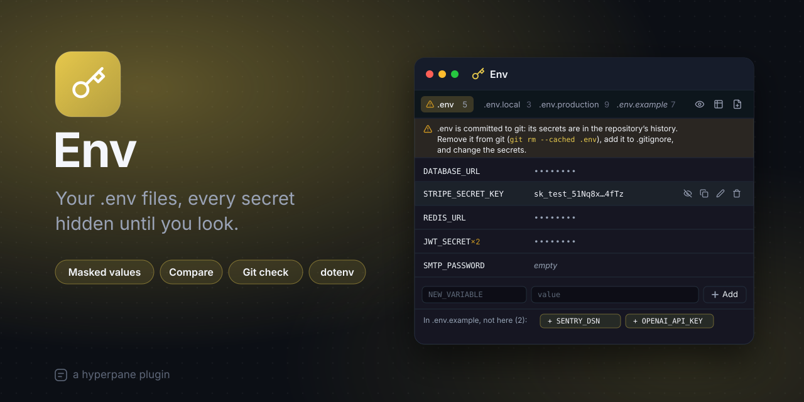

# Env

Your `.env` files, every secret hidden until you look. Env finds every
`.env` file in your project and shows them in one window: change a value
without opening an editor, see which file is missing a variable, and get
warned before a secret ends up in git.

## Features

- **A tab per file:** `.env`, `.env.local`, `.env.production`,
  `prod.env` and the rest, each with how many variables it has.
- **Values stay hidden** (`••••••••`) until you show one, or all of them;
  copy a value without showing it.
- **Edit in place:** double-click a value to change it, a name to rename
  it, or add a variable in the row at the bottom.
- **Your file stays yours:** only the variable's own lines change.
  Comments, blank lines, the order, `export`, quotes and Windows line
  endings are kept.
- **Compare:** every variable against every file, with what's `missing`
  in red (click to add it) and `≠` where the values differ.
- **Examples:** `.env.example` and its kind show their values, and a file
  beside one lists what the example has that it hasn't, each with Add.
- **Git check:** a warning when a secrets file is committed to git, or
  isn't ignored and could be.
- **Live:** the window follows changes on disk, from your editor or a
  script.

## How to use

1. Open a project, then open Env: **+** on the project, **New env**, or
   right-click the canvas.
2. Pick a file's tab. ⚠ marks one that git has, or doesn't ignore.
3. Click the eye on a row to show its value, or the eye in the bar to show
   them all.
4. Double-click a value to change it: Enter saves, Shift+Enter is a new
   line, Escape cancels.
5. Click **Compare** in the bar to see every file side by side, or **New
   .env file** to make one (a copy of the example beside it, when there is
   one).

## Good to know

- **What it finds:** `.env`, `.env.<anything>` and `<anything>.env`, in
  the project's folder and three levels down, not in `node_modules`,
  `.git`, `dist`, `build`, `target`, `vendor`, `.venv` and the like. The
  project's own come first, then by folder.
- **Examples** are `.env.example`, `.env.sample`, `.env.template` (and
  `-dist`, `-defaults`): the variables a project needs, with placeholders.
- **A file committed to git** has its secrets in the repository's history:
  remove it from git (`git rm --cached`), add it to `.gitignore`, and
  change the secrets. **One that isn't ignored** could be committed: add it
  to `.gitignore`. Without git, or outside a repository, nothing's said.
- **An edit is made on the file as the window saw it.** If the file
  changed on disk since, the edit is refused and the window shows the file
  as it is now.
- **A variable that's there twice** shows `×2`: the last one counts, and
  is the one changed.
- Files over 1 MB aren't shown: open them in the Editor.

## How it works

The server part reads the files and asks git about each one: whether it's
committed (`git ls-files`) and whether it's ignored (`git check-ignore
--no-index`).

What's read is what dotenv reads: `KEY=value`, `export KEY=value`, values
bare (up to a ` #` comment), `'single'`, `"double"` (with `\n`, `\t`,
`\"`, `\\`) or `` `backticks` ``, quoted ones over several lines. Lines
that aren't a variable are kept, and said.

A new variable goes after the last one. A value is written bare when it
can be, in `'single'` quotes when it has spaces or `#`, in `"double"`
quotes (with `\n`) when it has line breaks or quotes, so it reads back the
same.

## Develop

```sh
./build.sh --test
```

## License

MIT, © 2026 Astralyx. See [LICENSE](LICENSE).
